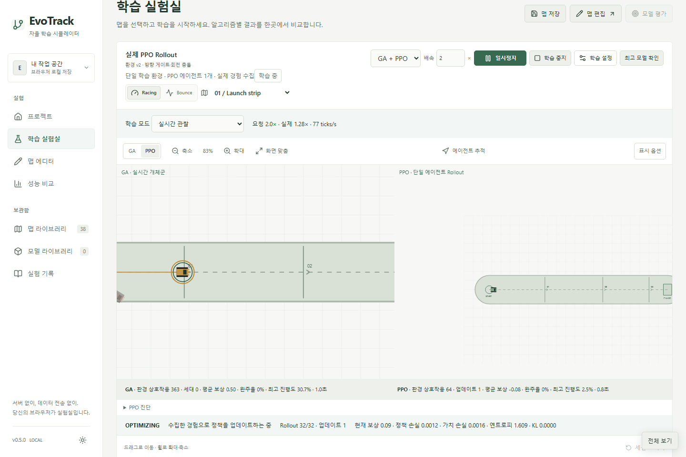
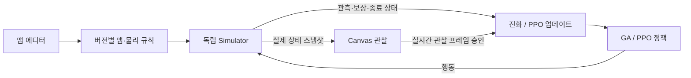

# EvoTrack

**Design tracks. Train intelligence. Watch it evolve.**

직접 만든 물리 환경에서 유전 알고리즘과 강화학습을 훈련하고, 실제 학습 과정을 관찰하는 브라우저 AI 실험실입니다.

[**웹에서 실행하기 →**](https://oyueo-mm.github.io/EvoTrack/) · [실험·검증 보고서](docs/v05-report.md)

[](https://github.com/oyueo-mm/EvoTrack/actions/workflows/pages.yml)



## 직접 만들고, 학습하고, 비교하세요

EvoTrack은 Racing과 Bounce 물리 환경을 만들고 신경망을 학습하는 로컬 우선 프로그램입니다. 캔버스에서 코스를 편집하고, 알고리즘을 선택한 뒤 에이전트가 수집하는 실제 경험과 정책 변화를 관찰할 수 있습니다.

학습은 Web Worker에서 진행됩니다. 서버나 학습 API 없이 맵·모델·실험을 현재 브라우저에 저장합니다. 최고 정책의 고정 평가 주행, 체크포인트 재개, 다른 호환 맵에서의 평가를 지원합니다.

| 기능           | 할 수 있는 일                                                  |
| -------------- | -------------------------------------------------------------- |
| Racing         | 조향·속도·방향 게이트·장애물 회피 학습                         |
| Bounce         | 점프·이동 발판·붕괴 발판·탄성·타이밍 학습                      |
| 맵 에디터      | 도로 드래그, 크기·회전 핸들, 각도 스냅, 레이어 잠금, 실행 취소 |
| 실시간 관찰    | GA 개체군과 단일 PPO의 실제 학습 상태를 나란히 확인            |
| 최고 모델 확인 | 학습 일시정지 → 별도 고정 정책 평가 → 재생·저장·복귀           |
| 맵 라이브러리  | 추천 16개 대표 과제, 모드·난이도·학습 목표·변형·사용자 맵 필터 |
| 데이터 관리    | 추론 모델·학습 체크포인트·전체 작업 공간 백업/복원             |

## GA와 PPO

|            | GA · Genetic Algorithm                  | PPO · Proximal Policy Optimization             |
| ---------- | --------------------------------------- | ---------------------------------------------- |
| 학습 방식  | 여러 신경망을 선택·교차·돌연변이로 진화 | 실제 경험으로 Actor-Critic 정책 최적화         |
| 학습 개체  | 기본 32개, 설정 가능한 독립 환경        | **에이전트 1개, Simulator 1개**                |
| 화면       | 실제 세대 개체군의 동시 주행            | 실제 확률적 행동·Rollout·업데이트 단계         |
| 최고 정책  | 세대 우승자와 역대 최고 적합도          | 동일 시드·조건에서 주기적으로 평가한 최고 정책 |
| 체크포인트 | 개체군·최고 정책·RNG, 세대 경계         | Actor·Critic·Adam·RNG·환경 상태, 업데이트 경계 |

GA + PPO 모드에서도 PPO 병렬 환경은 사용하지 않습니다. 카메라는 알고리즘마다 독립적으로 확대·이동·추적할 수 있습니다. 실시간 관찰은 화면이 프레임을 그린 뒤 다음 Worker 작업을 승인합니다. 빠른 학습은 일부 렌더링을 생략하며 실제 현재 학습 상태를 표시합니다.

## 환경과 편집

새 맵은 **물리 환경 v5**를 사용합니다. 기존 v1~v4 맵·모델은 원래 규칙으로 실행하며, 편집할 때 새 ID의 최신 편집본을 만듭니다. 원본 ID와 데이터는 보존됩니다.

| 요소             | 기능                                                            |
| ---------------- | --------------------------------------------------------------- |
| 도로·벽·게이트   | 주행 영역, 충돌, 순서와 방향을 갖는 통과 조건                   |
| 가시·폭탄        | 실패 조건과 장애물 회피                                         |
| 이동 발판        | 가로·세로·사용자 지정 방향, 진폭·주기·위상, 탑승과 점프         |
| 일회용 발판      | 첫 착지 후 기본 0.4초 뒤 붕괴, 에피소드마다 복원, 선택적 재등장 |
| 점프대·탄성 발판 | 방향 발사, 반발 계수, 점프 보조·속도 제한                       |
| 속도 벨트        | 방향 또는 현재 속도 기준 가속·감속                              |
| 중간 보상        | 구역·게이트, 1회·반복·쿨다운 조건                               |

발판의 실행 상태는 개체별 Simulator에 저장됩니다. 한 GA 개체가 무너뜨린 발판이 다른 개체에게 영향을 주지 않습니다. 전체 개체 관찰 시 지형 상태는 선택 개체 또는 현재 최고 개체를 기준으로 표시합니다.


## 빠른 시작

Node.js **22 LTS**를 기준으로 검증합니다.

```sh
npm ci
npm run dev
```

터미널에 표시되는 `/EvoTrack/` 주소를 엽니다.

```sh
npm test
npx playwright install chromium
npm run test:e2e
npm run build
```

Windows에서 Node가 PATH에 없다면 `C:\Program Files\nodejs`를 PATH에 추가하세요. E2E는 전용 포트 5187을 사용합니다.

## 사용 순서

1. 맵 라이브러리에서 모드·난이도·학습 목표로 코스를 선택합니다.
2. GA, PPO 또는 GA + PPO를 고르고 카드 오른쪽 위에서 학습을 시작합니다.
3. 실제 주행, 진행도·완주율·처리량과 PPO 진단을 관찰합니다.
4. **최고 모델 확인**으로 학습을 멈추고 고정 정책을 재생합니다.
5. 추론용 모델 또는 학습 재개용 체크포인트를 저장합니다.
6. 모델 라이브러리에서 같은 환경·관측·행동 스키마의 다른 맵을 평가합니다.

PPO의 선택적 커리큘럼은 v5 Bounce에서 기초 이동부터 복합 코스로 이어집니다. 연속 두 번의 고정 평가에서 완주율 2/3 이상·진행도 90% 이상일 때 다음 단계로 넘어갑니다. 단일 맵 학습도 그대로 사용할 수 있습니다.

에디터는 휠·핀치 줌, 우클릭/빈 공간 드래그 팬, Ctrl+세로 드래그 줌, 미니맵을 지원합니다. 수동 테스트는 WASD·방향키·Space·터치 버튼으로 조작하고 R로 재시도합니다. **전체 보기**는 `Alt+Enter`, 복귀는 `Esc`입니다.

## 홈 시연의 출처

홈은 Racing/Bounce와 Easy/Medium/Hard 환경을 순환합니다. Launch strip·First jump는 실제 GA 세대 0·1·4·10의 정책 기록을 재생합니다. 다른 코스는 **스크립트 기반 물리 시연**이며 AI 학습 결과로 표시하지 않습니다. 시연 정보와 접근성 설명에서 출처를 확인할 수 있습니다.

화면 밖·숨겨진 탭에서는 연산을 멈추고, reduced-motion 설정에서는 자동 재생하지 않습니다. 홈에서 별도 학습을 수행하지 않습니다.

## 구조

React 19 · TypeScript · Vite · TensorFlow.js · Canvas 2D · Web Workers · IndexedDB · Lucide · Tailwind CSS를 사용합니다.



물리 timestep은 항상 1/60초입니다. PPO rollout 경계에서도 에피소드를 이어가며, 종료와 시간 제한을 구분해 GAE를 계산합니다. v5 Bounce는 발판 가장자리·높이·이동 속도·붕괴 상태를 포함하는 18입력 관측을 사용합니다. 기존 12입력 모델과 자동 호환된다고 가정하지 않습니다.

## 측정과 한계

Core Ultra 7 256V, Windows, TensorFlow.js CPU에서 기존 버전과 같은 환경·32,768 스텝 예산·3개 학습 시드로 예비 비교했습니다. 완주율, 첫 완주까지의 샘플 수, 진행도, 처리량, 미학습 맵 평가를 기록했습니다. 원시 자료와 평균·표준편차는 [v0.5 실험 보고서](docs/v05-report.md)에 있습니다.

Worker의 CPU/WebGL 실측에서는 이 작은 모델에 CPU가 더 빨랐습니다. 기본 백엔드는 CPU이며, WebGPU는 현재 빌드에서 지원하지 않습니다. GPU가 모든 모델에서 느리다는 뜻은 아닙니다.

신규 코스 14개는 스크립트로 물리적 완주를 검증했습니다. **모든 코스에서 AI 학습이 성공한 것은 아닙니다.** 일회용 발판과 복합 코스의 단기 PPO 학습, 커리큘럼 전환, 미학습 코스 일반화에는 제한이 있습니다. 3개 시드의 예비 실험은 장기 성능 보장이 아닙니다.

재현 명령:

```sh
npm run validate:learning
npx tsx scripts/benchmark-v05.ts .cache/benchmark.json
npx tsx scripts/study-v05.ts
node scripts/verify-static.mjs
```

## 저장과 호환성

- 맵·모델·실험은 현재 origin의 IndexedDB에 저장합니다. 로컬 사이트와 공개 사이트 저장소는 별개입니다.
- 추론 모델은 고정 정책 가중치, 체크포인트는 학습 재개 상태를 포함합니다.
- 최신 PPO 체크포인트는 완료된 업데이트 경계에서 에피소드·발판 상태를 보존합니다. 과거 체크포인트도 불러올 수 있으며 환경 상태가 없으면 새 에피소드로 재개합니다.
- **데이터 백업 · 이전**에서 전체 JSON을 내보내거나 복원합니다. 중복 ID는 미리 확인하고 쓰기 실패는 롤백합니다.
- 브라우저 저장소를 지우기 전에 백업하세요. 이 프로젝트는 사용자 데이터를 서버로 전송하지 않습니다.

## 테스트와 배포

Vitest는 물리·GAE·손실·정책 업데이트·저장·호환성을 검증합니다. Playwright는 실제 Worker 학습, 카메라 입력, 에디터·백업·홈·모바일 흐름을 검증합니다.

`main` 푸시 후 GitHub Actions가 단위/E2E/TypeScript/빌드를 실행해 GitHub Pages에 배포하고, 공개 URL에서 다시 UI 테스트를 실행합니다. 개발 소스 전용 Worker 테스트·백엔드 측정은 공개 검사에서 제외되며 실제 공개 Worker 실행은 UI 테스트로 검증합니다.

```powershell
$env:EVOTRACK_BASE_URL = 'https://oyueo-mm.github.io/EvoTrack/'
npm run test:e2e
```

## 문서

- [v0.5 구현·실험·제한 사항](docs/v05-report.md)
- [이전 학습 UX·물리 요소](docs/learning-ux-elements.md)
- [실제 학습과 화면 동기화](docs/observable-learning.md)
- [최고 정책과 v4 에디터](docs/best-policy-v4-editor.md)
- [에디터·수동 플레이](docs/editor-play-workflow.md)
- [실시간 GA·호환성](docs/live-evolution.md)
- [설계 문서](docs/ARCHITECTURE.md)
- [이전 README의 구현·운영 기록](docs/README-v04-archive.md)

## 라이선스

현재 저장소에는 별도의 라이선스 파일이 포함돼 있지 않습니다.
