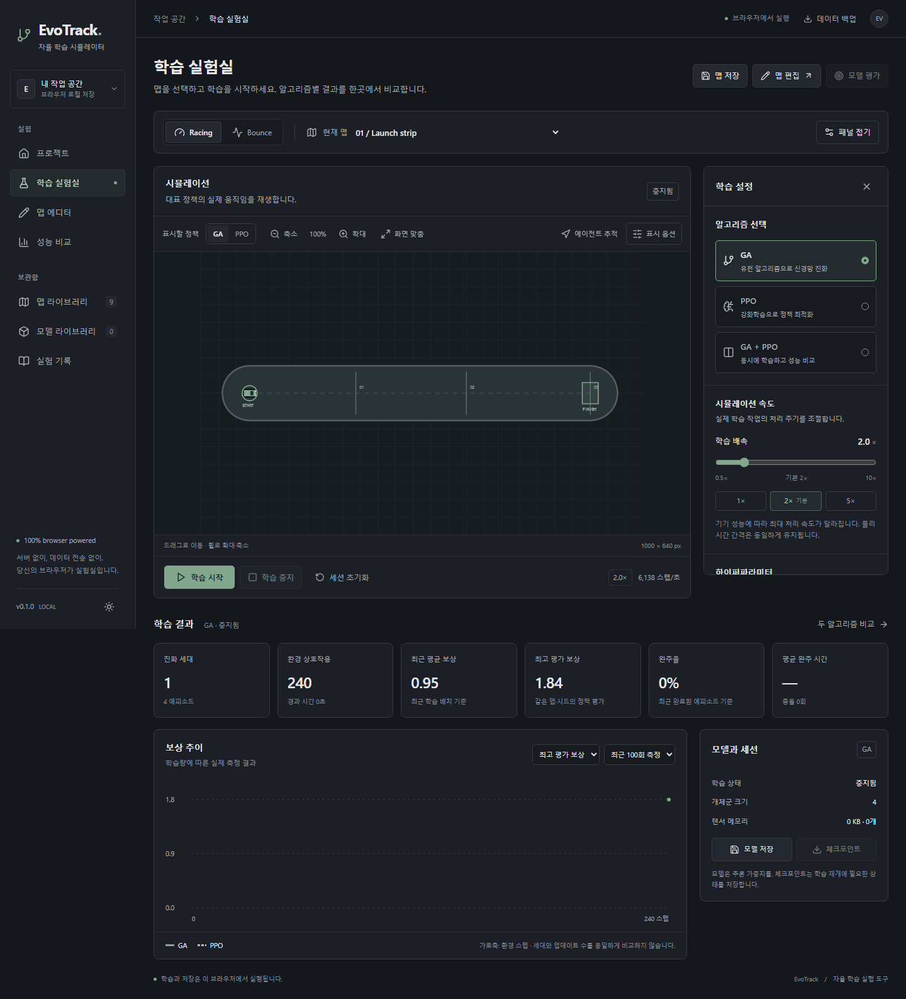
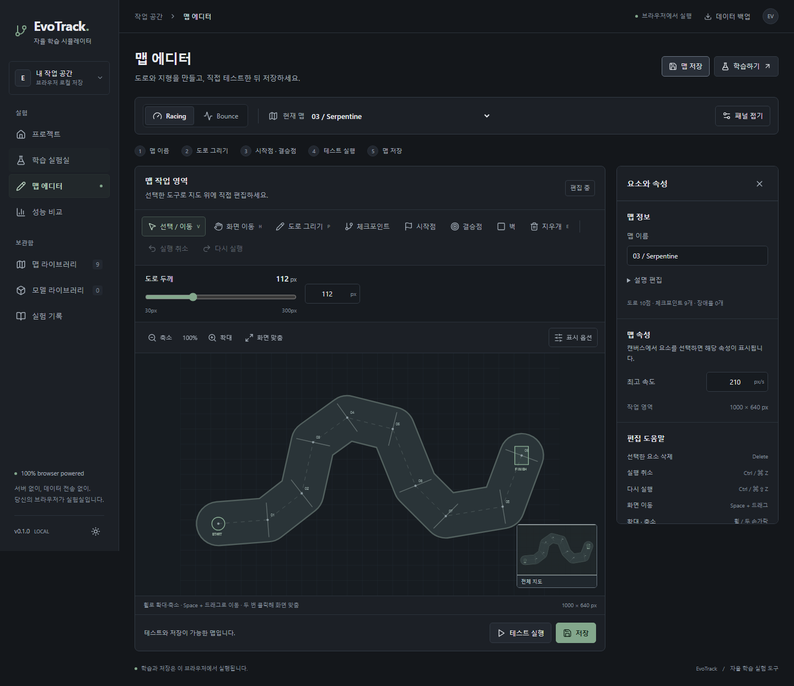

# UI/UX 개선 · 2026-10-24

## 1. 핵심 변경

학습 실험실과 맵 에디터를 중립색 다크 테마, 절제된 그린 강조색, 일관된 입력·버튼·패널로 교체했습니다. 기존 Racing/Bounce 환경, GA/PPO 알고리즘, Worker, IndexedDB, 모델·체크포인트·평가 경로는 유지합니다. 기존 DB를 초기화하거나 저장된 사용자 자료를 변환하지 않습니다.

## 2. 디자인 원칙

- 제목 → 현재 모드/맵 → 캔버스 → 학습 조작 → 결과 순서로 배치했습니다. 장식용 영문 태그·과한 배지·네온색을 줄였습니다.
- 색·배경·경계·문자·간격·반경을 CSS 토큰으로 관리합니다. 라이트 테마는 화면 반전 대신 실제 색상 토큰을 사용합니다.
- 편집 도구와 주요 뷰 조작에 아이콘과 텍스트를 함께 제공합니다. 상태는 색과 한국어 문구를 함께 표시합니다.
- GA 그래프는 실선, PPO 그래프는 보조 중립색 점선으로 표시합니다. 그래프 너비를 관찰하여 모바일에서도 글자가 압축되지 않게 합니다.

## 3. 학습 실험실

- 모드와 현재 맵은 공통 상단 컨텍스트에 모았습니다. 설정은 우측, 결과는 캔버스 아래에 둡니다.
- GA/PPO/동시 비교의 선택 상태를 `aria-pressed`와 라디오 표시·설명으로 구분합니다. 해당 알고리즘의 설정만 보여줍니다.
- 시작·일시정지·재개는 하나의 주요 버튼으로 전환하고, 중지와 세션 초기화는 보조 스타일로 분리했습니다.
- **설정 기본값 복원**은 입력값을 복원하고 학습 지표를 유지합니다. **세션 초기화**는 중지된 세션의 지표와 미저장 정책을 비우며 맵·저장 모델·실험은 유지합니다.
- 세대/업데이트, 환경 스텝, 배치 평균 보상, 최고 평가 보상, 완주율, 평균 완료 시간·충돌 수를 구분합니다.
- 그래프는 최근 50/100/300회 **측정**을 선택합니다. 에피소드별 데이터가 아닌 스냅샷을 에피소드 기록으로 표시하지 않습니다.
- 센서·궤적·충돌 영역·전체 개체·고스트를 표시 옵션에 모았습니다. 정책 탭과 에이전트 추적도 같은 뷰 조작부에 있습니다.

## 4. 맵 에디터

- 이름 → 도로/발판 → 시작·결승점 → 직접 테스트 → 저장의 제작 순서를 표시합니다.
- 선택/이동, 도로, 체크포인트, 시작·결승점, 벽, 발판, 지우개, 팬, 실행 취소/다시 실행을 라벨이 있는 도구로 제공합니다.
- 선택한 도로 제어점·체크포인트·시작점·결승점·장애물에 따라 속성 패널이 바뀝니다. 체크포인트 순서, 시작 방향, 객체 크기·위치·복제·이동 주기를 편집할 수 있습니다.
- **테스트 실행**은 학습 없이 실제 Simulator를 사용합니다. Racing은 방향키, Bounce는 좌우·Space로 조작하고, 터치 버튼도 제공합니다. 테스트는 학습 스텝·가중치를 변경하지 않습니다.
- 한 번의 그리기·이동·지우개 드래그는 하나의 undo 작업으로 묶습니다. 입력 필드에서 단축키가 편집을 가로채지 않도록 했습니다.

## 5. 속도 슬라이더

`RangeField`로 0.5×~10×, 0.1 단위의 네이티브 range를 사용합니다. 현재 값, 최소·최대·기본 2×를 표시하고 1/2/5× 프리셋을 제공합니다. 접근성 이름과 단위가 포함된 값 설명을 제공합니다.

학습 중 변경은 `UPDATE_CONFIG`로 두 Worker 각각에 전달합니다. 기존 Worker 스케줄러의 `180 / speed` 처리 주기를 바꾸며 물리의 고정 1/60초는 유지합니다. 최저·최고 배속에서 실제 iteration/step 처리량을 비교하는 테스트를 추가했습니다. 포화 상태의 기기에서 10×의 선형 가속을 보장하지 않습니다.

## 6. 두께·지우개·카메라

- 도로 두께: 전체 도로에 30~300px 슬라이더·숫자 입력을 제공하고 즉시 렌더링합니다. 구간별 가변 두께는 지원하지 않습니다.
- 지우개: 반경 8~80px 브러시로 도로 포인트·구간, 체크포인트, 시작·결승점, 장애물을 지웁니다. 선택 후 삭제와 캔버스 Delete도 지원합니다.
- 삭제된 시작·결승점과 끊긴 도로는 일시적인 `draft`로 표시합니다. 저장·학습·테스트 전에 구체적인 오류를 반환합니다. 도로를 지운 뒤 양 끝을 몰래 연결하지 않습니다. 복원은 undo 또는 명시적인 구간 연결로 수행합니다.
- 줌: 40~400%, 휠·트랙패드 Ctrl-wheel·두 손가락 핀치. 화면 좌표와 월드 좌표를 분리하여 커서/핀치 중심의 월드 좌표를 유지합니다.
- 팬: 손 도구, 선택 도구의 빈 공간, Space+드래그, 마우스 가운데 버튼. 화면 맞춤·두 번 클릭으로 전체 보기로 복원합니다.
- 미니맵은 현재 보이는 영역을 표시하고 클릭해 이동합니다.

## 7. 검증 및 스크린샷

검증 결과는 `PROGRESS.md`의 이번 개선 항목에 기록합니다. E2E에서 기존 GA/PPO·동시 학습·모델/체크포인트·새 맵 평가를 재검증하고 새 조작을 함께 검사합니다. 정적 경로와 스크린샷은 `node scripts/verify-static.mjs --screenshots`로 재현합니다. 생성된 검증 파일은 `.cache/ui-review/`에 저장하며, 문서에 포함한 이미지는 격리된 테스트 컨텍스트에서 생성한 화면입니다.

실행 결과: TypeScript 검사·프로덕션 빌드 성공, 단위 테스트 28개·E2E 10개 통과. 정적 `/EvoTrack/` 실행 검사에서도 Worker 학습과 새로고침을 확인했습니다.

| 학습 실험실                            | 맵 에디터                            |
| -------------------------------------- | ------------------------------------ |
|  |  |

[모바일 에디터](ui-redesign/mobile.png) · [라이트 테마](ui-redesign/light.png)

## 8. 남은 개선

구간별 도로 폭·베지어 스무딩, 겹친 요소를 순환 선택하는 기능, 미니맵 내부 드래그, 더 넓은 키보드/스크린리더 검증은 후속 범위입니다. 터치 검증은 Chromium의 터치 입력 에뮬레이션이며 실제 iOS/Safari 하드웨어 검증은 아닙니다. 기존 CPU 학습과 PPO 에피소드 경계 재개 제한은 동일합니다.

## 9. 변경 구조

`Studio`는 실험 대상·뷰·제어·결과를 조합합니다. `TrainingPanel`과 `EditorPanel`은 설정/선택 속성을 분리합니다. `ui.tsx`는 필드·슬라이더·섹션·도구 버튼·토글을 재사용합니다. `core/editor.ts`는 선택·삭제·좌표 변환을 DOM 없이 검증합니다. `World`는 실제 물리 재생과 입력/카메라를 담당합니다. App은 탐색·저장·학습 세션 연결을 유지합니다.
