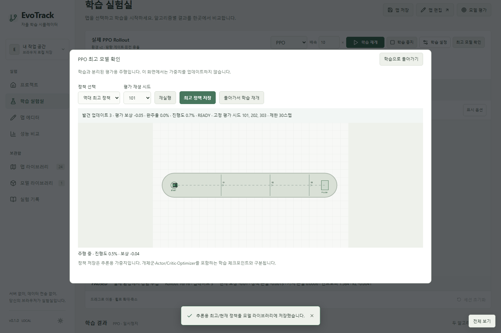
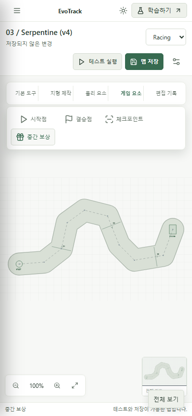

# 학습 제어·최고 정책·v4 에디터 개선

## 학습 UI와 정책 검사

알고리즘, 배속, 시작/일시정지/재개, 중지, 설정과 최고 모델 확인을 시뮬레이션 카드 오른쪽 위에 배치했다. 왼쪽은 제목·환경 버전·실행 상태와 맵 선택이다. 넓은 캔버스, GA/PPO 분할 관찰, 플로팅 설정, 전체 보기를 유지한다.

최고 모델 확인은 두 Worker 모두 PAUSE ACK를 받은 뒤 선택 알고리즘의 정책을 복제한다. 별도 Simulator에서 고정 가중치로 주행하며 재실행·시드 선택·추론 모델 저장을 지원한다. 돌아가기는 일시정지를 유지하고, 명시적 재개 버튼으로 학습을 이어간다. STOP 이후에도 Worker의 정책 기록은 유지되어 재확인·저장이 가능하다. 새 세션/초기화에서는 기록을 새로 시작한다.

GA는 재생산 전에 실제 세대 우승 정책과 상태를 복제하고 역대 최고 적합도·발견 세대·성공 여부를 보관한다. 현재 세대가 진행 중이면 그 시점까지의 최고 개체임을 표시한다. 과거 체크포인트에 발견 세대가 없으면 0(미기록)으로 두고 재평가 출처를 표시한다.

PPO는 첫 업데이트와 이후 5회 간격으로 시드 101/202/303, 동일한 맵·에피소드 제한에서 결정론적 정책 평가를 수행한다. 성공률, 평균 진행도, 평균 보상 순으로 역대 최고를 비교한다. 검사/중지 시 현재 정책도 같은 조건으로 평가한다. 최적화 중간 정책은 확인할 수 있지만 역대 최고로 승격하지 않는다. 단일 rollout 보상은 최고 선정 기준이 아니다.

PPOTrainer의 학습 Simulator는 정확히 1개다. 기존 확률적 행동 수집, Actor/Critic 업데이트, Adam 상태를 유지한다. 평가 Simulator는 정책 추론에만 사용하고 학습 버퍼·RNG·가중치를 변경하지 않는다. 추론 저장과 전체 학습 체크포인트를 구분하며 체크포인트에는 최고 정책 기록도 포함한다. 기존 IndexedDB 저장소·백업 구조를 삭제하거나 초기화하지 않는다.

## v4 편집과 호환성

새 Racing/Bounce는 v4다. v1/v2/v3를 편집하면 새 ID의 v4 편집본을 자동 생성한다. 원본 맵·연결 모델·기존 환경의 평가/학습 규칙은 보존한다. 기존 v4 편집은 같은 ID를 유지하며, 학습 원본을 분리해야 할 때만 별도 사본을 만든다. 업그레이드 버튼은 제거했다.

편집본 이름은 알려진 구형 편집 접미사와 버전 접미사를 정리한 `원래 이름 (v4)`다. 연속 변환에서도 접미사를 중첩하지 않는다. `sourceMapId`는 선택적 출처 정보이므로 과거 맵 가져오기도 허용한다.

## 도구 아이콘

| 도구                    | Lucide 아이콘   |
| ----------------------- | --------------- |
| 선택 / 이동             | MousePointer2   |
| 화면 이동               | Hand            |
| 지우개                  | Eraser          |
| 도로 그리기             | Pencil          |
| 고정 발판               | Layers          |
| 이동 발판 / 이동 장애물 | MoveHorizontal  |
| 벽                      | Square          |
| 가시                    | TriangleAlert   |
| 폭탄                    | Bomb            |
| 점프대                  | ArrowUpFromLine |
| 탄성 발판               | Waves           |
| 속도 벨트               | ChevronsRight   |
| 시작점                  | Play            |
| 결승점                  | Flag            |
| 부활 지점               | MapPin          |
| 체크포인트              | ScanLine        |
| 중간 보상               | Gift            |
| 실행 취소 / 다시 실행   | Undo2 / Redo2   |

기본 도구·지형 제작·물리 요소·게임 요소·편집 기록의 5개 그룹이다. 모든 편집 도구는 서로 다른 아이콘을 사용하고 이름·기능 설명·배정된 단축키를 툴팁에 제공한다. 아이콘 크기·버튼 영역을 통일하고 선택 상태를 표시한다. 900px 이하에서는 그룹을 접고 선택한 그룹만 팝오버로 펼친다. 긴 가로 스크롤을 사용하지 않는다.

## 검증

- 단위 테스트 103개: 세대 교체 전 우승 정책, 체크포인트 연속성, PPO 단일 환경 객체 재사용, 고정 평가 재현성 및 학습 상태 불변, 최고 선정 기준, v4 복사·이름·고유 아이콘 포함.
- Playwright 38개: 실제 GA/PPO/동시 학습, 검사 중 전체 학습 정지, 중지 후 검사·저장, 최고 기록 체크포인트 복원, 원본 JSON 보존, 모바일 그룹·툴팁, 회전·도로·터치·저장·백업·전체 보기 회귀 포함.
- `npm run build`: TypeScript 프로젝트 검사 및 프로덕션 번들.
- 배포 워크플로는 main에서 단위/E2E/빌드 후 Pages 배포, 공개 URL 브라우저 검증을 수행한다. 공개 테스트는 소스 모듈을 직접 사용하는 3개만 제외한다.

정책 검사는 현재 브라우저 세션의 기록을 사용한다. 새로고침 후 기록을 재사용하려면 모델 또는 체크포인트로 저장해야 한다. 짧은 테스트 주행의 완료 여부는 학습 품질 보장이 아니며, 실제 장기 학습 성능은 맵과 설정에 따라 달라진다.
