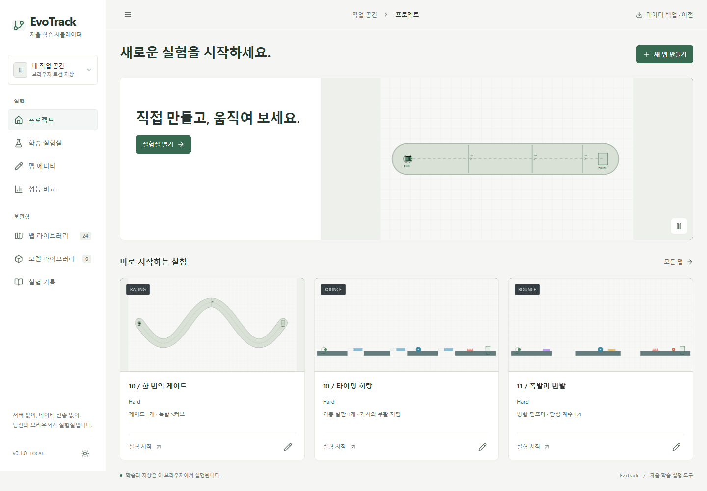
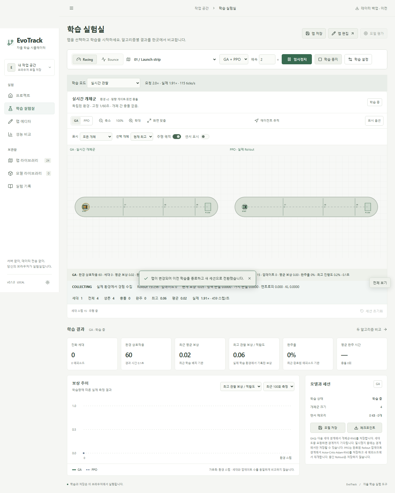
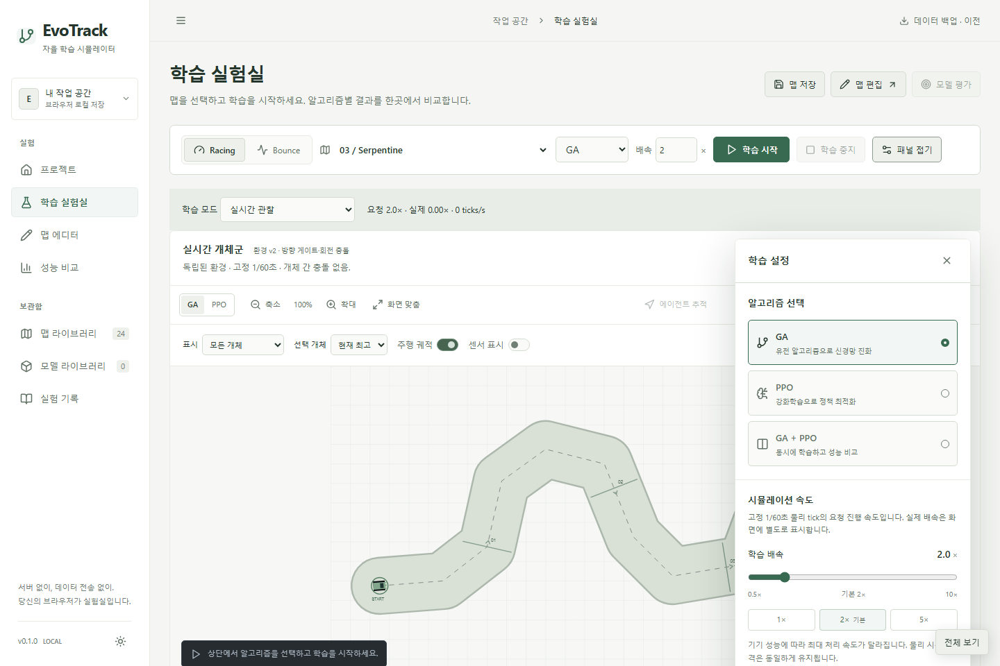
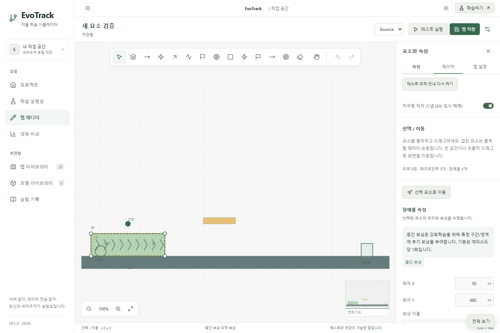

# EvoTrack 학습 UX·맵 요소·홈 화면 개선

2026-10-24. 기준 main `fd3014be0652d894fbdbd2fef60bf39b41a66043`을 fetch해 확인하고 `feat/learning-ux-elements-home`에서 작업했습니다. 기존 IndexedDB, 기본 맵 24개, 모델·실험·백업과 observable learning을 유지합니다.

## 1. 추가한 요소

- 탄성 발판의 점프 보조: `bounceCoefficient`, `liftBoost`, `tangentBoost`, `minLaunchSpeed`, `maxLaunchSpeed`.
- 속도 벨트: `kind: belt`, 가속/감속·속도/벨트 방향·세기·최대 영향 속도.
- 중간 보상: `kind: reward`, 직사각형 영역과 회전 가능한 유한 통과 게이트. 이름·설명·표시·사용 환경·학습 전용 옵션을 지원합니다.

도구 모음, 이름 있는 레이어, 선택·잠금·숨기기, Inspector, 복제/삭제와 회전/크기 핸들에 통합했습니다. 새 맵은 환경 v4이며 이전 맵은 **환경 v4 편집본 만들기**로 별도 ID로 복제해 사용합니다. 기존 맵에 새 물리를 자동 적용하지 않습니다.

## 2. 탄성 발판

v4에서는 윗면 접촉 시 법선 방향으로 다음 속도 impulse를 더합니다.

`clamp(max(minLaunchSpeed, 입사 법선 속도 × bounceCoefficient + liftBoost), 0, maxLaunchSpeed)`

기본값은 탄성 0.8, 점프 보조 120px/s, 최소 260px/s, 최대 900px/s, 접선 보조 0px/s입니다. 반사만 하는 것보다 느린 접촉에서도 안정적으로 도약합니다. Inspector에서 모든 값을 조절할 수 있습니다. 보조·탄성·최소/최대를 모두 0으로 설정하면 서서 일반 점프할 수 있습니다. 기존 v1/v2/v3의 탄성/점프 규칙은 그대로 유지합니다.

## 3. 속도 벨트

벨트는 비고체 구역입니다. 기본 `velocity`에서는 가속이 현재 속도 벡터 방향으로 힘을 더하고 감속은 같은 방향의 속력을 줄입니다. 감속이 역방향 추진으로 뒤집히지 않습니다. 정지에 가까우면 벨트 방향을 가속의 fallback으로 사용합니다.

`beltOrientation`에서는 가속이 벨트 방향 힘을 더합니다. 감속은 벨트 축 방향의 속도 성분에만 저항합니다. 세기 기본값은 300px/s², 최대 영향 속도는 480px/s입니다. 최대 영향 속도는 벨트가 추가하는 가속의 상한이며 다른 힘으로 이미 더 빠른 개체를 강제로 감속하는 제한이 아닙니다. 녹색/주황색과 화살표로 가속/감속 구역을 구분합니다.

## 4. 중간 보상

| 속성   | 동작                                   |
| ------ | -------------------------------------- |
| 보상값 | -100~100, 기본 +1                      |
| 발동   | 에피소드당 1회 / 매번 / 쿨다운         |
| 조건   | 영역 진입 / 유한 중심선 통과 / 머무름  |
| 쿨다운 | 시뮬레이션 시간 기준, 기본 1초         |
| 필터   | Racing / Bounce / 둘 다, 학습에만 적용 |
| 표시   | 시각 표시 여부, 이름·설명              |

영역은 OBB 접촉을 사용하고 게이트 통과는 앞·뒤 위치의 선분과 회전된 유한 게이트를 검사합니다. 기본 1회 발동은 계속 머물러도 추가 보상을 주지 않습니다. 반복 진입은 나갔다 다시 들어와야 합니다. **머무름 + 매번**은 보상값을 초당으로 계산하고 나머지는 발동당 값입니다. 쿨다운+머무름은 간격마다 정액을 지급합니다. 반복 머무름의 양수 보상은 의도적으로 머무는 행동을 유도할 수 있으므로 기본값은 1회입니다. 에피소드 reset에서 발동 이력을 초기화합니다.

보상은 `Simulator.step()` 반환 reward와 상태 누적 reward에 포함됩니다. GA 적합도와 PPO rollout은 같은 값을 사용합니다. 수동 테스트는 작은 누적 보상 출력으로 확인할 수 있고 학습 전용 옵션은 수동 테스트의 지급을 제외합니다. 체크포인트·부활 표식과 별도 요소이며 완료 조건을 바꾸지 않습니다.

벨트/보상은 고체 센서의 장애물로 보고하지 않습니다. 기존 12차원 위치·속도·진행도 관측 및 행동 스키마를 유지하며 새 물리 의미는 환경 v4로 구분합니다. 별도의 접촉 채널이나 지도 일반화 학습을 새로 구현한 것은 아닙니다.

## 5. 테스트 안내

처음 테스트할 때만 작은 접이식 도움말을 보여주며 이후에는 최소 조작 바를 유지합니다. 닫기와 **다시 보지 않기**는 localStorage에 기록합니다. **조작 안내**로 필요할 때 열고, Inspector의 **테스트 조작 안내 다시 켜기**로 초기화할 수 있습니다. 닫기/부활 후 캔버스에 포커스를 돌려 바로 WASD를 사용할 수 있습니다. 터치 조작 버튼은 모바일에서 유지합니다.

## 6. 도킹형 메뉴

1100px보다 넓은 데스크톱에서는 에디터도 왼쪽 메뉴가 레이아웃 안에 들어가 본문을 밉니다. 펼침 너비 192~360px, 미니바 64px, 너비·접힘 상태 저장을 유지합니다. 열고 닫을 때 부드럽게 전환하고 reduced-motion에서는 전환을 생략합니다. 좁은 화면/모바일은 기존 drawer와 배경 닫기를 유지합니다.

## 7. 학습 실험실

시작/재개·일시정지·중지, 맵·환경·알고리즘·배속과 설정 열기 버튼은 상단 sticky 제어바에 있습니다. 설정은 **기본 닫힘**이며 필요할 때 캔버스 오른쪽 위에 떠오릅니다. 고정 우측 열이 캔버스 폭을 소비하지 않습니다. 열었을 때 캔버스 좌표와 폭은 유지되며 일부가 패널에 가려지고, 닫으면 그 영역을 다시 전부 볼 수 있습니다. 모바일은 화면 아래쪽 패널로 전환합니다.

GA/PPO 실제 환경 스냅샷, 프레임 승인, 관찰/빠른 학습, pause ACK, 배속·환경 스텝 구분과 탭 숨김 시 관찰 정지를 유지합니다.

## 8. 즉시 전환

실행 중이거나 일시정지 상태에서 맵을 선택하면 이전 Worker를 종료하고 스냅샷·통계·대기 요청을 정리한 뒤 새 맵으로 새 세션을 시작합니다. 추천 horizon이 있으면 반영하고 알고리즘·배속·표시 설정은 유지합니다. 알고리즘이나 Racing/Bounce 전환도 중지 버튼이나 확인 모달 없이 새 세션으로 바꿉니다. 아직 학습하지 않은 준비 상태에서는 선택만 바꾸고 시작 버튼을 기다립니다.

프레임 승인에는 세션 ID가 포함되고 이전 Worker의 메시지는 새 상태에 반영되지 않습니다. E2E에서 Worker 생성/종료를 계측해 PPO 단독은 1개, GA+PPO는 2개만 남고 이전 Worker가 실제 terminate되는지 확인했습니다. 새 맵은 이전 학습 가중치·중간 진행도를 이어받지 않습니다. 저장된 모델·실험은 그대로 보존합니다.

에디터 안에서의 독립 편집본 작업은 유지합니다. 이 경로는 실행 원본을 바꾸지 않고 저장 시 다음 세션 적용/지금 재시작 선택을 제공합니다.

## 9. 전체 보기

학습 실험실, 에디터, 맵 라이브러리 목록/프리뷰와 비교 화면에 **전체 보기** 버튼 및 `Alt+Enter`를 제공합니다. 주변 메뉴·제목·footer를 숨기고 캔버스/목록 영역을 넓힙니다. `Esc` 또는 **전체 보기 종료**로 복귀합니다. 브라우저 권한을 요구하는 OS fullscreen 대신 앱 내부 immersive mode입니다. 페이지 이동 시 정상 화면으로 돌아옵니다.

## 10. 홈 화면

hero의 시도/충돌 문구와 학습 결과 여부 설명을 기본 화면에서 제거하고 아이콘 재생 제어만 남겼습니다. 긴 설명과 중복 소개를 줄이고 학습 원본/편집본 배너는 홈에서 표시하지 않습니다. 추천 3개 카드도 정적 World 대신 실제 Simulator를 사용하는 작은 Canvas 애니메이션으로 바꿨습니다. 이름·난이도·핵심 요소 한 줄로 정보를 줄였습니다.

추천 프리뷰는 캐시한 스크립트 조작으로 움직이는 물리 데모이며 실제 사용자 학습을 대신하지 않습니다. 화면 밖/백그라운드에서는 물리를 정지하고 reduced-motion을 존중합니다. 학습 실험실에는 이 데모를 사용하지 않습니다.

## 11. 검증

- 단위 테스트 **95/95**: 기존 물리/학습/저장, v3 반발 보존, v4 점프 보조와 0 보조, 벨트 가속/감속·방향·상한, 보상 1회/재진입/쿨다운/초당 지급/음수/환경 필터/학습 전용, 실제 GA 적합도 및 PPO rollout 반영, JSON 복원·손상값 거부.
- 로컬 Chromium E2E **34/34**: 새 요소 속성 저장/복원·수동 영향·v4 모델 저장, 안내 닫기/유지/복구와 키보드 포커스, 도킹과 전체 보기, 기본 닫힘 플로팅 패널, 세션 ID/Worker cleanup, 실제 홈 프리뷰 이동. 기존 observable learning·32/64 개체·PPO 전이 동일성·모바일·백업/체크포인트 재개 회귀 포함.
- TypeScript와 프로덕션 빌드 통과. GitHub Actions는 전체 검사 후 Pages를 배포하고 공개 URL에서 UI E2E를 다시 실행합니다. 개발 소스 전용 프로토콜/처리량 테스트 3개는 공개 URL 검사에서 제외합니다.

화면 증거:

## 12–14. 최종 반영과 배포

force push 없이 검증 브랜치를 main에 통합합니다. 최종 커밋 SHA와 Actions 실행 결과는 완료 응답의 링크로 제공합니다. 공개 사이트는 https://oyueo-mm.github.io/EvoTrack/ 입니다.

## 15. 제한

새 요소와 탄성 보조는 v4 맵/편집본에서 사용하며, 이전 맵의 물리는 자동 변경하지 않습니다. 기존 버전 모델을 v4에 자동 적용하지 않습니다. 전체 보기는 앱 내부 모드입니다. 중간 세대/rollout 복원 및 모든 코스의 학습 성공을 새로 보장하지 않습니다. 맵/알고리즘 전환은 명시적으로 새 학습을 시작하므로 저장하지 않은 이전 세션 진행은 이어지지 않습니다. 사용자 설정에 따라 반복 보상을 머무름 유도로 사용할 수 있습니다.
