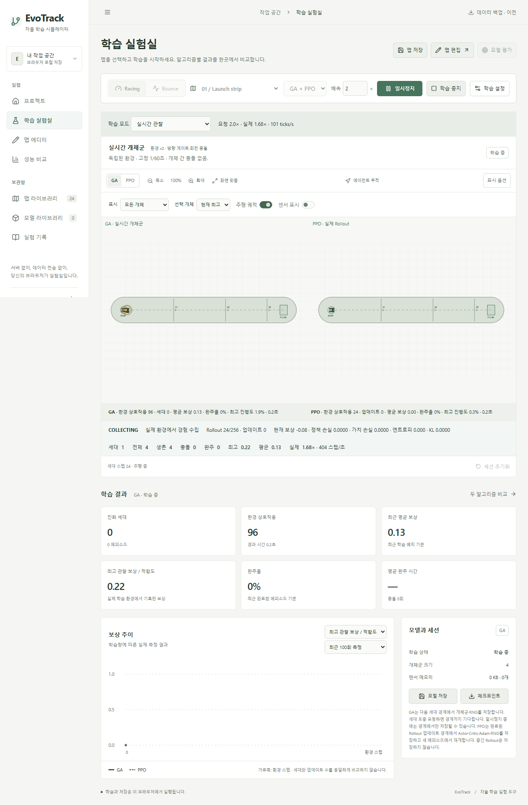
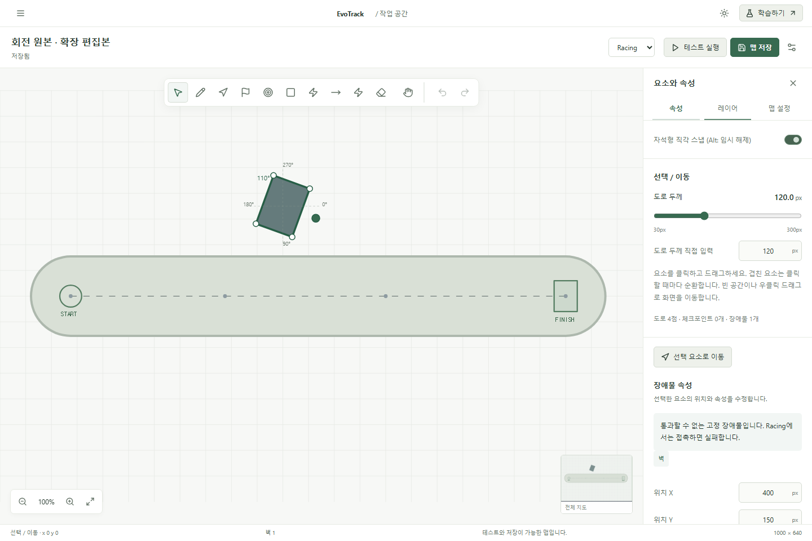
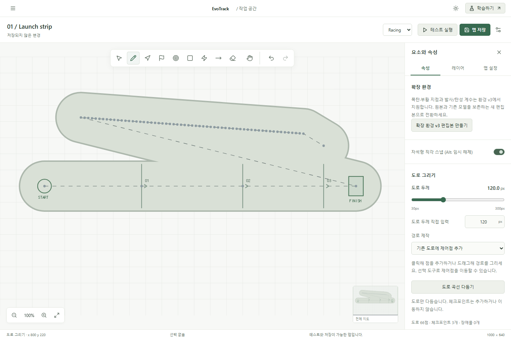

# 편집 버그 수정과 실제 학습 상태 동기화

2026-10-24. 기준 main: `748ee2d0d4ad1976ec3791449284529b552d3af4`. 로컬 변경이 없는 상태에서 원격 main을 fetch해 동일함을 확인하고 `fix/observable-learning-editor` 브랜치에서 작업했습니다. 수정 전 단위 테스트 75개가 통과했습니다. 기존 IndexedDB를 삭제하거나 사용자 데이터를 변경하지 않았습니다.

## 1. 도로 드래그 실패의 실제 원인

World의 pointermove가 도로/배치 드래그를 4px 이상 움직이면 이전 편집을 되돌린 뒤 `pan`으로 바꾸고 있었습니다. 도로가 클릭으로만 추가되는 원인이었습니다. 도로 드래그는 이제 고정된 `road` 동작으로 유지하고, 포인터 구간을 약 12 월드 픽셀 간격으로 보간하여 실제 제어점을 추가합니다. 클릭 추가, 기본 이어 그리기, 명시적 새 경로 교체, 제어점 이동·두께·스무딩을 유지합니다. 체크포인트는 생성하지 않습니다. 전체 드래그는 동일한 transaction ID를 사용해 Undo/Redo 하나로 처리합니다.

## 2. 팬/줌 이벤트 우선순위

드래그 시작 시 판별한 동작을 pointer capture가 끝날 때까지 유지합니다. 우선순위는 활성 변형 핸들 → Ctrl+왼쪽 세로 줌 → 손 도구/Space/오른쪽·중간 버튼 팬 → 기존 요소 선택·이동 → 도구 생성/그리기 → 선택 도구의 빈 공간 팬입니다. 도로만 일반 드래그의 팬 전환에서 제외했습니다. Ctrl을 드래그 도중 누르더라도 기존 변형·그리기를 줌으로 바꾸지 않습니다. 위로 Ctrl 드래그하면 확대, 아래로 드래그하면 축소하며 시작 커서의 월드 좌표를 앵커로 삼습니다. 범위는 기존 0.4–4×이고 휠/핀치는 유지합니다. 카메라 작업은 맵 데이터를 바꾸지 않습니다. 취소·blur·lost capture는 진행 중 편집을 시작 스냅샷으로 되돌립니다.

## 3. 회전 핸들 제한과 수정

기존 v1 맵은 OBB 회전 물리를 지원하지 않아 핸들이 숨겨집니다. 조작 가능한 것처럼 보이게 하지 않고 **이 맵은 기존 물리 규칙을 사용합니다. 객체 회전을 사용하려면 확장 환경 v3 편집본을 만드세요.**라고 설명합니다. v3 복사 버튼은 새 ID를 만들고 원본·모델을 보존합니다. v2/v3는 변환 없이 회전할 수 있습니다. 변형 핸들을 카메라 단축키보다 먼저 판정하고 적중 반경을 14 화면 픽셀로 늘렸으며, 회전 핸들을 더 큰 초록 원으로 구분했습니다. 현재 각도도 캔버스에 표시합니다. 회전은 기존 렌더링·선택·OBB 충돌·센서·물리에 같은 객체 angle을 사용합니다.

## 4. 자석 스냅

`core/angle-snap.ts`의 독립 설정은 획득 ±7°, 해제 ±10°입니다. 0/90/180/270° 근처에서만 붙고 100°나 110°에서는 자유 회전합니다. 356°는 0°로 붙습니다. 이전 스냅 각도를 드래그 상태에 보관해 경계 떨림을 방지합니다. 기본 활성화, Inspector 토글, Alt 임시 해제, 스냅 시 캔버스 피드백을 지원합니다. Inspector의 각도 직접 입력은 원래 값을 사용합니다. Shift는 크기 비율 유지 기능으로 남겨 회전 자석 기능과 분리했습니다.

## 5. GA 실제 학습

GeneticTrainer가 실제 개체마다 독립 Simulator와 정책을 가지고 같은 1/60초 tick에서 진행하는 구조를 유지했습니다. Worker 스냅샷의 population은 바로 그 Simulator들의 상태입니다. 모든 개체가 종료되면 같은 상태의 reward를 적합도로 사용해 엘리트·교차·돌연변이를 적용합니다. 세대 경계도 한 스냅샷으로 표시한 후 다음 세대를 출발시킵니다. 전체·생존·최고·선택 개체, 센서·궤적, 충돌/완주·보상·환경 스텝을 유지합니다. 전송량을 줄이기 위해 궤적은 현재 추적 개체만 보내며, 모든 개체의 실제 위치와 센서는 유지합니다.

## 6. PPO 실제 Rollout

PPOTrainer는 하나의 식별된 실제 Simulator를 소유합니다. generator 기반 `advance()`가 관측 → Actor 확률/샘플링 → 물리 한 스텝 → obs/action/log probability/value/reward/next value/종료 경계 기록을 실행합니다. COLLECTING 중 이 상태를 전송합니다. Rollout이 차면 OPTIMIZING에서 GAE·advantage 정규화·clipped objective·value loss·entropy·gradient clipping·Adam을 실행하고 미니배치 사이에서 yield합니다. READY는 완료된 업데이트 경계입니다. UI의 PAUSED는 Worker의 별도 정지 상태입니다.

업데이트 중에는 마지막 실제 환경 상태를 유지하고 진행 문구·rollout 크기·업데이트 수·손실·entropy·KL을 표시합니다. 다음 rollout은 갱신된 정책으로 새 주행을 시작합니다. Worker의 숨겨진 정책 평가/별도 Simulator 완주와 World의 대표 정책 재생 경로를 제거했습니다. World에서 생성하는 Simulator는 수동 테스트용뿐입니다. 모델 라이브러리의 명시적 고정 정책 평가는 별도 평가 Worker로 유지합니다. `run()`은 CLI 학습 검증을 위한 동기 편의 함수이며 UI 학습 루프는 사용하지 않습니다.

## 7. 화면과 학습 데이터의 일치

학습 캔버스는 Worker가 보낸 실제 상태를 그대로 그립니다. GA 단위 테스트는 32/64개 환경의 공통 tick, 독립 이동, 최종 상태 reward와 적합도의 정확한 일치, 체크포인트 결정성을 검증합니다. PPO 단위 테스트는 매 advance의 기록 상태와 실제 Simulator 상태의 일치, 최적화 중 샘플 수 고정, 가중치 변경, 중간 저장 거부와 TensorFlow 텐서 해제를 검증합니다.

브라우저에서는 실제 포인터로 100px 이상 도로 그리기와 Undo/Redo, 87°→90° 자석 회전·110° 자유 회전·저장 복원을 검증합니다. PPO의 환경 ID와 전이 기록·렌더링 상태 전체를 연속 프레임에서 대조하고 실제 가중치 checksum의 변경을 확인합니다. 상세 상태/전이는 개발 모드 또는 명시적 `?debug=1`에서만 노출합니다.

## 8. 관찰·배속·일시정지

기본 observe 모드는 스냅샷 sequence에 대해 캔버스가 그린 뒤 requestAnimationFrame에서 FRAME_ACK를 보냅니다. Worker는 미승인 스냅샷이 있으면 다음 학습 작업을 실행하지 않습니다. 한 승인에서 실행할 물리 tick은 최대 ceil(요청 배속 × 2), 한 작업 시간 예산은 약 10ms입니다. 2×의 프로토콜 테스트는 승인 없이 200ms 동안 샘플 0, 한 승인 뒤 최대 4샘플임을 확인합니다. 10×의 모든 물리 tick을 각각 화면 프레임으로 표시한다는 뜻은 아닙니다.

fast 모드는 승인 대기를 생략하고 같은 실제 환경을 시간 예산 내에서 가속하며 중간 프레임을 생략할 수 있습니다. 요청 0.5–10×는 유지하되 실제 공통 ticks/s ÷ 60과 환경 상호작용 합계를 구분합니다. GA 64개가 1tick 움직이면 공통 시간은 1tick이고 환경 상호작용은 64스텝입니다. 최적화·렌더 대기 시간이 실제 배속에 반영됩니다.

PAUSE는 현재 한 tick/미니배치를 끝내고 최종 스냅샷 후 ACK합니다. ACK 이후 샘플·가중치·업데이트·상태가 고정되는지 검증했습니다. observe 모드의 탭 숨김/실험실 이탈은 자동 일시정지하며 복귀 시 직접 재개합니다. 탭 숨김 테스트는 실제 탭 전환을 먼저 수행하고, headless 브라우저가 가시성 변경을 제공하지 않으면 visibilitychange를 모사합니다. 빠른 학습은 사용자가 명시적으로 선택한 경우 백그라운드 진행이 가능합니다.

## 9. 호환성과 학습 중 편집

맵 v1/v2/v3, 정책/행동/관측 스키마, GA/PPO 체크포인트 필드와 IndexedDB 저장소는 유지합니다. 선택적 `config.trainingMode`가 없는 이전 자료는 observe로 해석합니다. 숫자 설정 검증은 유지하며 새 모드 문자열은 별도로 검증합니다. 기존 맵/모델/실험을 삭제하거나 임의 변환하지 않습니다. 환경 버전 불일치 검사도 유지합니다.

학습 중 편집본 분기는 유지하며 observe에서는 먼저 일시정지합니다. 저장 시 다음 세션용 저장 또는 새 맵으로 지금 재시작을 선택합니다. 기존 세션은 원래 물리를 유지하고 모델/실험은 실제 학습 원본을 기록합니다. GA 체크포인트는 세대 경계, PPO는 완료된 rollout 업데이트 경계에서 저장합니다. 도중 요청은 실행 중에 경계까지 대기하고, 일시정지 상태의 중간 경계에서는 재개 후 요청하라는 안내를 제공합니다.

## 10. 테스트

단위 테스트 **86/86**, 로컬 Chromium E2E **29/29**, TypeScript·프로덕션 빌드 통과. 최종 계측·저장 안내 변경 뒤 핵심 E2E도 재실행했습니다. 기존 맵 편집/수동 테스트/부활, 단독·동시 학습, 모델·체크포인트 저장/재개, 평가, 작업 공간 백업/복원, 모바일을 포함합니다. 공개 URL에서는 개발 소스 모듈 전용 프로토콜/처리량 3개를 제외하고 동일한 UI 검증을 실행합니다. 공개 결과는 최종 Actions 실행 링크를 참고하세요.

실제 학습 회귀도 CPU로 측정했습니다. 단순 Racing에서 GA는 보상 -2.52→64.27, PPO는 -2.52→29.64, 평지 Bounce에서 GA는 20.22→51.16, PPO는 20.22→50.41이었습니다. Racing PPO 완주율은 0%였으며 모든 코스의 학습 성공이나 일반화를 주장하지 않습니다. [학습 결과](results/learning-validation.json).

## 11. 성능

[실측 JSON](results/observable-performance.json). 로컬 Windows Chromium headless, 2.2초 표본, debug 계측 활성화 기준입니다. 다른 기기의 성능을 보장하지 않습니다.

| 대상  | 프레임 간격 p95 | UI 조작 완료 | 상태 크기(JSON 환산) | 실제 공통 ticks/s |
| ----- | --------------: | -----------: | -------------------: | ----------------: |
| GA 32 |          16.7ms |         13ms |              24,187B |             102.9 |
| GA 64 |          16.8ms |         12ms |              36,520B |             106.0 |
| PPO   |          16.8ms |          8ms |         최대 12,169B |              51.8 |

요청 배속은 2×입니다. PPO는 64샘플·4epochs·16미니배치의 실제 업데이트/승인 대기를 포함합니다. PPO 스냅샷은 약 27.3Hz였고 실제 pointerdown 이벤트 타임스탬프부터 핸들러 시작까지 지연은 42.2ms였습니다. UI 조작 완료 시간은 자동화 selectOption의 왕복 시간으로 별도 지표입니다. byte는 UTF-8 JSON 환산치이며 브라우저 내부 structured clone의 전송 바이트와 동일하지 않습니다. 원본 프레임·전이 계측은 Actions artifact에 보존합니다.

## 12. 데스크톱 화면

## 13–15. main, Actions, 공개 사이트

검증한 브랜치를 force push 없이 main에 통합하고 GitHub Pages workflow를 실행합니다. 최종 커밋 SHA와 build/deploy/공개 verify 결과는 완료 응답의 커밋·Actions 링크에 기록합니다. 공개 사이트: https://oyueo-mm.github.io/EvoTrack/ . 기존 정적 배포 구조를 유지하고 PPO 원본 성능 계측 파일을 검증 artifact에 추가했습니다.

## 16. 제한 사항

완전한 중간 GA 세대/PPO rollout 복원은 지원하지 않습니다. 저장은 위 경계에서만 정확히 지원합니다. PPO rollout 경계에서는 새 에피소드를 시작합니다. 관찰 모드도 배속에 따라 한 렌더 프레임 사이에 제한된 여러 물리 tick을 실행하므로 모든 1/60초 상태를 개별 화면에 보여주는 것은 아닙니다. 빠른 학습은 중간 프레임을 생략합니다. 정책이 단기간에 모든 맵을 완주한다는 보장은 없습니다. headless 가시성 모사의 한계와 성능 표본 범위는 위 검증 설명에 명시했습니다.
