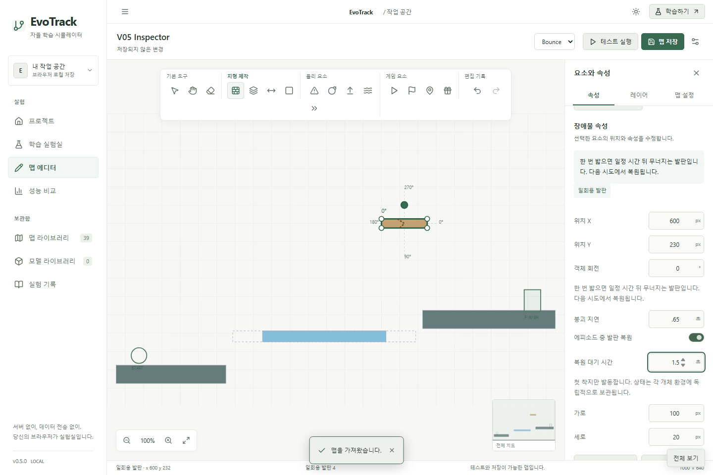
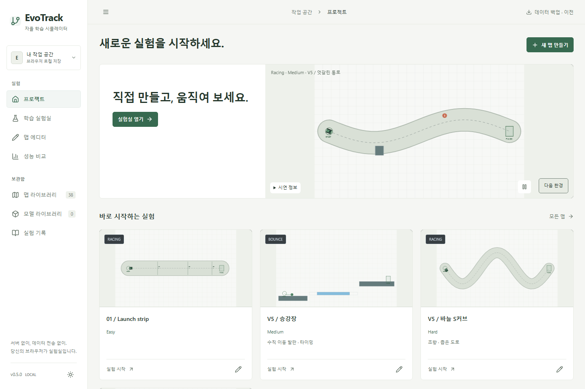

# EvoTrack v0.5 — 구현·실험·검증 보고서

## 물리 환경과 데이터 호환성

새 환경은 v5다. v1~v4 Simulator 분기는 유지하고, 새 Bounce 충돌 처리는 `bounce-v5.ts`에 분리했다. v5의 이동 발판은 수평·수직·임의 방향의 사인파 궤적을 지원한다. 위치·속도는 같은 시간·시드에서 결정론적이다. 진폭 A, 주기 T의 최대 속도는 2πA/T로 계산해 Inspector에 표시하며 독립 속도 설정과의 모순을 없앴다. 기본 timestep은 1/60초, 이동체와 캐릭터의 상대 속도에 따른 내부 substep으로 빠른 발판 관통을 방지한다. 탑승·상승·하강·점프·중력·천장 끼임을 검증했다.

일회용 발판은 첫 착지 뒤 기본 0.4초에 붕괴한다. 지연·복원 여부·복원 시간을 설정할 수 있다. 균열, 붕괴 카운트다운과 짧은 투명도 변화로 상태를 표시한다. 상태는 `AgentState.platforms`와 개별 Simulator에 저장하며 정적 맵을 수정하지 않는다. GA 관찰 지형은 선택 개체 또는 최고 개체의 상태를 사용한다. 새 에피소드·수동 재시도에서 복원하며 선택적 재등장도 지원한다.

에디터는 방향·위상·주기·진폭·붕괴 속성, 점선 경로·끝점·움직임 프리뷰를 제공한다. 기존의 회전·크기·복사·레이어·실행 취소·저장·JSON·백업 경로에 새 요소를 통합했다. 기존 맵을 편집하면 새 ID의 v5 사본을 만들고 원본 및 연결 모델을 보존한다. `(v4) (v5) 편집본` 같은 알려진 자동 접미사는 정리한다. 이미 v5인 사용자 맵 이름은 자동으로 다시 바꾸지 않는다.

기존 관측/행동 모델은 원래 스키마에서 사용한다. v5 Bounce는 관측 v2·18입력, 그 외 기존 환경은 관측 v1·12입력이다. 모델 검증, Actor/Critic·Adam 텐서 형태, 평가 호환성을 입력 크기와 스키마별로 검증한다. IndexedDB DB 버전과 저장소는 변경하지 않았다. 과거 체크포인트의 새 메타데이터는 선택적이므로 기존 가져오기도 유지한다.

## PPO 카메라와 학습 정확성

분할 화면의 오른쪽 World에는 `interactive`, `viewport`, `onViewportChange`, 추적·시드·에피소드 props가 빠져 있었다. 하나였던 카메라 상태도 GA/PPO별로 분리했다. 실제 휠·버튼·우클릭 팬·화면 맞춤·추적 중 줌·알고리즘 전환 및 단독/분할 PPO 터치 핀치로 뷰포트 값을 검증한다. 추적은 줌을 유지한다.

PPO는 정확히 하나의 학습 Simulator를 사용한다. 발견한 주요 문제는 다음과 같다.

- Rollout 시작마다 환경 reset: 긴 에피소드가 중간에 끊겨 먼 목표·점프 연속 동작을 경험하기 어려웠다. 실패 테스트로 재현한 뒤 종료/시간 제한에서만 reset하도록 수정했다.
- 가치 손실의 `0.5 × 0.5`: MSE 계수를 한 번만 적용하는 명시적 `combinedPPOLoss`로 정리하고 분석적 gradient 테스트를 추가했다.
- 무작위 출력층의 초기 행동 편향: 출력층을 작게 초기화해 거의 균등한 행동 분포에서 탐험한다. 기존 모델/체크포인트를 불러오면 저장 가중치를 그대로 적용한다.

GAE의 진짜 종료·시간 제한 bootstrap·경계 차단은 기존 구현이 올바른 부분을 유지했다. Advantage 정규화, global gradient norm 0.5 clipping, 비음수 approximate KL, Target KL 조기 종료, 유한 loss/gradient 검사를 사용한다. 보상 단위를 바꿔 성능 향상으로 계산하지 않았으며, 기존 환경 보상은 유지한다.

발판 관측은 현재 지지면 끝까지의 거리, 다음 발판 높이, 이동 속도, 붕괴 상태, 종류를 선별했다. 초기 중심 위치 관측과 비교한 예비 기록은 캐시에 보존하고, 최종 6개 지형·동적 특징을 가린 실험을 별도로 수행했다. 추가 정보가 모든 단기 실험에서 더 좋았다고 주장하지 않는다. 동적 플랫폼에 필요한 상태 표현과 단기 최적화 난이도는 별개다.

진단 패널은 정책/가치 손실, 엔트로피, KL, 행동 확률 평균, advantage 평균·표준편차, gradient norm, clip fraction, 실제 에피소드 길이, 가중치 변화, 수집·업데이트 시간을 표시한다. 단순 정지/전진, 낙하, 점프 부족을 보상 수치와 구분해 분석할 수 있다.

체크포인트는 완료된 업데이트 경계에서 Actor·Critic·Adam·RNG와 진행 중인 에피소드·발판 상태를 보관한다. 과거 환경 상태 없는 체크포인트는 새 에피소드로 재개한다. TensorFlow 부동소수점 복원 연산은 수치 오차 허용 범위에서 검증한다. 최고 모델 검사는 학습을 모두 멈추고 별도 Simulator에 복제한 정책으로 평가하며, 중지 이후에도 기록을 유지한다.

## 선택적 커리큘럼

v5 Bounce에서 이동 → 점프 → 가시 → 수평 발판 → 수직 발판 → 일회용 발판 → 탄성 → 선택한 목표 맵으로 학습한다. 한 번에 Simulator 하나만 사용한다. 같은 환경·관측·행동 스키마를 검사하고 가중치/Adam을 이어 쓴다. 주기적인 고정 시드 101/202/303 평가에서 완주율 2/3·진행도 90% 이상을 연속 두 번 달성해야 전환한다. 단계별 최고 기록은 해당 맵 기준으로 새로 시작한다. 체크포인트에 목표 맵·단계·통과 횟수를 저장한다.

## 성능 최적화와 실험 조건

기준 커밋 `627c2c5bc896aeb9457b30fdea306cd68d653090`의 소스를 별도 캐시 경로에 읽기 전용으로 추출해 같은 측정 스크립트로 실행했다. 장치: Intel Core Ultra 7 256V, Windows 11 (10.0.26200), 논리 코어 8개. 로컬 Node 24.19.0/TensorFlow.js CPU (CI는 Node 22). 학습 시드 17/42/89, 고정 평가 시드 101/202/303, horizon 900, rollout 256, epochs 4, minibatch 64. 환경 상호작용 예산 32,768. GA는 동시 개체 묶음 때문에 마지막 tick에서 최대 31개를 초과할 수 있으며 전후 실제 스텝 수는 일치한다. PPO 마지막 예산 경계에서는 직전 완료 정책을 평가한다.

물리 step(관측 포함), observe, 추론, reset, 직렬화, 학습·평가 시간을 분리해 측정했다. 각 마이크로 프로파일은 원시 JSON에 횟수와 밀리초를 기록한다. OS 스케줄링·온도·JIT 영향을 받는 예비 수치이며 브라우저 FPS와 Node 처리량을 혼동하지 않는다.

GA는 신경망 scratch buffer를 재사용하고, 충돌 검사마다 만들던 필터 배열을 정적 충돌 목록으로 바꿨다. 연산 순서·가중치·행동·종료 조건은 유지한다. PPO는 다음 관측과 Critic bootstrap 값을 재사용하고, 같은 상태 센서를 캐시한다. 손실 진단용 중복 forward를 제거했다. 빠른 모드는 요청 배속의 시계 대기 대신 10ms 작업 예산과 cooperative yield를 사용한다. 관찰 모드 ACK·고정 timestep·중지 응답은 유지한다. 정책 검사는 학습과 분리돼 있다.

| 알고리즘 | 맵             | 기존 transitions/s, 평균 ± 표본 SD | 개선 transitions/s, 평균 ± 표본 SD | 최종 완주율     |
| -------- | -------------- | ---------------------------------- | ---------------------------------- | --------------- |
| GA       | r-straight     | 79,002 ± 1,979                     | 85,551 ± 2,547                     | 100.0% → 100.0% |
| GA       | r-serpent      | 76,565 ± 1,264                     | 82,597 ± 1,535                     | 0.0% → 0.0%     |
| GA       | r-angled-walls | 39,655 ± 1,434                     | 56,757 ± 1,449                     | 100.0% → 100.0% |
| GA       | b-jump         | 302,866 ± 32,736                   | 450,034 ± 70,297                   | 100.0% → 100.0% |
| GA       | b-moving       | 322,336 ± 5,000                    | 451,161 ± 5,937                    | 100.0% → 100.0% |
| GA       | b-spikes       | 317,350 ± 18,354                   | 473,366 ± 42,036                   | 100.0% → 100.0% |
| PPO      | r-straight     | 6,239 ± 119                        | 8,131 ± 148                        | 100.0% → 100.0% |
| PPO      | r-serpent      | 6,284 ± 11                         | 8,078 ± 105                        | 33.3% → 66.7%   |
| PPO      | r-angled-walls | 5,181 ± 22                         | 7,741 ± 107                        | 66.7% → 100.0%  |
| PPO      | b-jump         | 7,689 ± 77                         | 8,771 ± 93                         | 33.3% → 33.3%   |
| PPO      | b-moving       | 7,693 ± 87                         | 8,783 ± 141                        | 66.7% → 100.0%  |
| PPO      | b-spikes       | 7,819 ± 98                         | 8,994 ± 135                        | 100.0% → 66.7%  |

- GA: 평균 처리량 189,629 → 266,578 transitions/s; 최종 정책 완주율 83.3% → 83.3%; 최고 평가 정책 완주율 83.3% → 83.3%.
  최초 성공 감지 샘플 수(성공한 실행만): 18,606 (15/18 실행) → 18,606 (15/18 실행). 미학습 호환 코스의 완주율 63.0% → 63.0%.
- PPO: 평균 처리량 6,817 → 8,416 transitions/s; 최종 정책 완주율 66.7% → 77.8%; 최고 평가 정책 완주율 94.4% → 100.0%.
  최초 성공 감지 샘플 수(성공한 실행만): 7,454 (17/18 실행) → 5,476 (18/18 실행). 미학습 호환 코스의 완주율 72.2% → 88.9%.

첫 성공 수치는 주기적인 고정 평가에서 **처음 성공을 감지한 시점**이다. PPO는 최대 5업데이트 간격, GA는 세대 경계에서 확인한다. 실패 실행을 제외한 평균만으로 전체 우위를 판단하면 안 된다. S커브 GA는 이 예산에서 여전히 완주하지 못했고, PPO 가시 코스의 최종 완주율은 100%에서 66.7%로 낮아졌다. 최고 정책 보관과 최종 정책의 안정성은 구분한다. 3개 시드 예비 실험은 통계적 유의성·전 코스 일반화를 보장하지 않는다.

GA 개체군 별 동일 시드 검증:

| 개체군 | 기존 transitions/s | 개선 transitions/s | 최고 가중치 checksum·점수 일치 |
| ------ | ------------------ | ------------------ | ------------------------------ |
| 32     | 75,420             | 82,302             | True                           |
| 64     | 74,813             | 81,703             | True                           |

원시 측정: [기준선](results/v05-baseline.json), [개선 버전](results/v05-improved.json). `profiles`에 환경별 물리·관측·추론·reset·직렬화 결과가 있다. 화면 p95·입력 지연·스냅샷 크기는 E2E artifacts의 `ppo-observation-performance.json`, `live-population-performance.json`에 따로 기록한다. 변경 전 동일 브라우저 p95를 별도 보존하지 않았으므로 그 수치의 개선률을 주장하지 않는다.

## 실제 Worker 백엔드 비교

별도 QA Worker에서 CPU → WebGL → WebGPU를 순차 측정했다. 각 백엔드에서 단일 PPO만 만들고 워밍업 1회 뒤 5업데이트·640 transitions를 측정한다. rollout 128, epochs 2, minibatch 64, 같은 Racing/seed/물리다.

| 백엔드 | transitions/s | 업데이트 평균 ms | 텐서 / bytes           |
| ------ | ------------- | ---------------- | ---------------------- |
| cpu    | 8,388         | 9.90             | 26 / 9296              |
| webgl  | 1,395         | 71.02            | 26 / 9296              |
| webgpu | 0             | 0.00             | 미지원: backend 미등록 |

작은 모델에서 CPU가 더 빨라 기본을 유지했다. 실제 Worker 시작 시 지원 여부를 검사하고 CPU로 돌아간다. WebGPU backend 패키지는 현재 빌드에 등록되지 않아 미지원으로 기록했다. 임의의 GPU 수치를 만들지 않았다. CPU 메모리 통계는 tfjs가 보고하는 상한 추정치다.

## 새 환경 실험과 장기 학습

새 물리는 이전 버전에 없으므로 기존 v4와 직접 성공률 비교하지 않는다. 각 32,768 samples·3개 시드에서 최종 관측, 마지막 6개 지형/이동 특징을 0으로 가린 관측, 커리큘럼을 비교했다. 아래는 최고 평가 정책의 완주율 / 평균 진행도다.

| 환경          | 전체 관측     | 특징 마스킹    | 커리큘럼       |
| ------------- | ------------- | -------------- | -------------- |
| b-v5-elevator | 66.7% / 75.3% | 100.0% / 96.0% | 100.0% / 96.1% |
| b-v5-crumble  | 0.0% / 32.4%  | 0.0% / 32.4%   | 0.0% / 32.4%   |
| b-v5-mixed    | 0.0% / 81.6%  | 0.0% / 81.6%   | 0.0% / 81.8%   |

일회용 발판과 종합 코스는 이 단기 예산에서 완주하지 못했다. 일부 정책은 첫 틈 앞이나 후반 안전 발판에서 멈춘다. 커리큘럼은 수평 발판 단계에서 정체되어 이후 단계를 모두 달성했다고 볼 수 없다. 승강장 과제는 커리큘럼의 쉬운 단계에서 얻은 정책도 평가상 완주할 수 있지만, 이것이 모든 단계 자동 통과를 의미하지 않는다. 마스킹이 오히려 좋은 승강장 결과도 있어 관측 차원 확대만으로 학습 향상을 단정할 수 없다.

[전체 새 환경·관측 비교](results/v05-new-environments.json). 별도로 512업데이트·131,072 samples 장기 실행에서 텐서 수가 안정적이며 trainer dispose 후 0개·0바이트로 돌아왔다. 파티클 등 무거운 시각 효과는 사용하지 않았다.

## 콘텐츠·중복 맵·홈

추천은 Racing 8개(기존 직선/S + 새 6개), Bounce 8개로 총 16개다. 라이브러리는 추천·전체·변형·튜토리얼·사용자 맵, 모드·난이도·학습 목표로 필터링한다. 원본과 사용자 맵은 삭제하지 않는다.

| 원본 / 변형                 | 실제 차이와 분류 근거                         |
| --------------------------- | --------------------------------------------- |
| 연속 S커브 / 한 번의 게이트 | 같은 중심선, 도로 폭과 게이트 수가 다름       |
| 연속 헤어핀 / 정밀 헤어핀   | 중심선 공유, 폭 110px와 80px의 정밀도 차이    |
| 지구력 / 게이트 없는 지구력 | 같은 경로, 게이트 보상·제약 유무              |
| 사선 장벽 / 폭탄 통과 구간  | 같은 길, 폭탄 위험 추가                       |
| 정밀 도약 / 재도전의 발판   | 같은 발판 기반, 수동 부활 표식과 폭탄 추가    |
| 움직이는 다리 / 타이밍 회랑 | 같은 이동 발판 배치 기반, 위험·부활 표식 차이 |
| 탄성 릴레이 / 폭발과 반발   | 같은 발판 경로 기반, 방향 발사·탄성·폭탄 차이 |

각 변형의 ID와 물리는 유지하고 `variantOf` 메타데이터로 연결했다. 기본 예제 `b-moving`도 이동 요소를 포함하지만 바닥이 연결된 기초 과제이므로 틈을 건너는 moving-gauntlet과 동일 과제로 취급하지 않았다. 튜토리얼 3개는 별도 필터로 보존한다.

신규 코스:

| ID              | 이름          | 난이도 | 핵심 목표           |
| --------------- | ------------- | ------ | ------------------- |
| r-v5-precision  | 바늘 S커브    | Hard   | 좁은 도로·연속 곡률 |
| r-v5-speed      | 가속과 감속   | Medium | 가속·제동           |
| r-v5-obstacles  | 엇갈린 통로   | Medium | 위험 회피           |
| r-v5-timing     | 횡단 신호     | Medium | 이동 장애물 타이밍  |
| r-v5-corners    | 고속 코너     | Hard   | 고속 조향           |
| r-v5-endurance  | 종합 주행     | Hard   | 복합 조작           |
| b-v5-flat       | 첫 걸음       | Easy   | 이동                |
| b-v5-jump       | 한 번의 점프  | Easy   | 기본 점프           |
| b-v5-horizontal | 왕복 다리     | Medium | 이동 발판           |
| b-v5-elevator   | 승강장        | Medium | 수직 발판           |
| b-v5-crumble    | 무너지는 길   | Medium | 붕괴 발판           |
| b-v5-elastic    | 탄성 도약     | Medium | 탄성·점프대         |
| b-v5-belt       | 속도 퍼즐     | Medium | 벨트·1회 보상       |
| b-v5-mixed      | 마지막 릴레이 | Hard   | 이동·붕괴·가시      |

모든 신규 맵은 seed 42, horizon 1800의 실제 Simulator·결정론적 조작으로 완주했다. 출발점·목표·간격·충돌·붕괴 시간은 단위 검증에 포함된다. 이 증거는 **물리적 도달 가능성**이며 AI 학습 성공이나 모든 시작 위상의 완주 증거가 아니다.

홈은 직선, S커브, 헤어핀, 정밀 주행, 종합 Racing, 속도 제어, 이동 장애물, 승강장, 붕괴 발판, 수평 발판, 탄성, 벨트, 복합 Bounce, 기본 점프를 순환한다. GA 세대 0·1·4·10의 실제 기록 2개 코스와 스크립트 물리 시연을 명확히 구분한다. 정적 정책 기록은 `home-recordings.json`에 실제 설정·시드·평가를 포함한다. 홈에서 학습을 수행하지 않는다. 추천 카드 4개는 실제 물리 프리뷰다.

공유 RAF, 20~30fps 상한, 카드 프리뷰 빈도 제한, 행동 데이터 캐시, IntersectionObserver, 숨겨진 탭 정지, reduced-motion과 수동 재생을 제공한다. 표시되지 않는 카드의 물리를 계산하지 않는다.

## README·검증·배포

README를 소개·기능·알고리즘 비교·환경·실행·사용 순서·구조·측정 한계·데이터·테스트·문서·라이선스의 프로젝트 소개서로 재작성했다. 실제 화면만 사용하고 Node 22 및 현재 package.json 명령을 확인했다. 유용한 이전 정보는 [README 아카이브](README-v04-archive.md)로 옮겼다. 별도 라이선스 파일이 없어 MIT라고 표기하지 않았다.

단위 테스트 130개: v1~v4 회귀, 발판 탑승/붕괴/복원/개체 독립성/빠른 이동/끼임, GAE/손실 gradient/rollout 연속성, Adam 복원, 새 맵 14개 완주, 출처 정책 재생, 이름과 스키마, 데이터 저장·백업.

Playwright 45개: 실제 GA/PPO/동시 학습, 카메라 휠·버튼·팬·추적·터치, 발판 Inspector 저장, 최신 편집 사본과 원본 JSON 보존, 홈 전환/정지/reduced-motion, 필터, 백엔드 측정, 최고 정책·체크포인트, 기존 편집·전체 보기·모바일·백업 회귀. 공개 URL에서는 직접 소스 모듈을 사용하는 Worker 검사 4개를 제외하고 UI 41개를 검증한다.

TypeScript 및 프로덕션 빌드는 `npm run build`로 검사한다. main은 fast-forward로 통합하고 force push를 사용하지 않는다. Pages 워크플로는 테스트·빌드 → 배포 → 공개 URL UI 검증 순서다. 완료된 최종 SHA와 Actions URL은 최종 응답에 명시한다.

## 남은 제한과 참고

WebGPU 미지원, 새 고난도 Bounce의 단기 PPO 미완주, 수평 발판 단계의 커리큘럼 정체, 일부 최종 정책 성능 하락, 제한된 3개 시드·고정 평가 조건이 남아 있다. CUDA나 다중 PPO 환경은 도입하지 않았다. 데이터 삭제·강제 푸시·기존 모델의 무단 스키마 변경은 수행하지 않았다.

수학 검토 참고: [PPO 원 논문](https://arxiv.org/abs/1707.06347), [Farama의 종료·시간 제한 및 bootstrap 설명](https://farama.org/Gymnasium-Terminated-Truncated-Step-API). 코드에서 확인한 reset·계수 문제와 외부 이론 설명은 구분했다.
